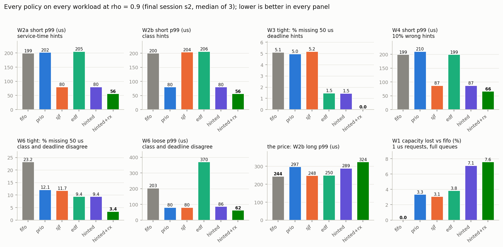
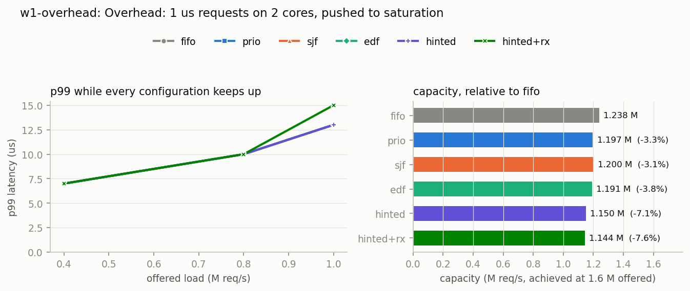
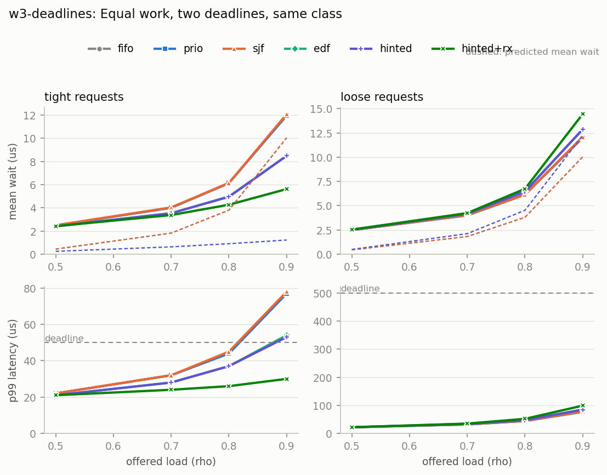
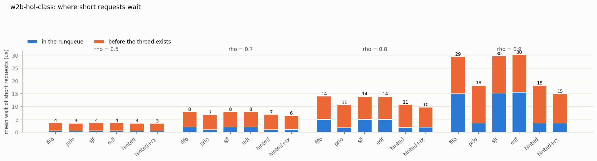
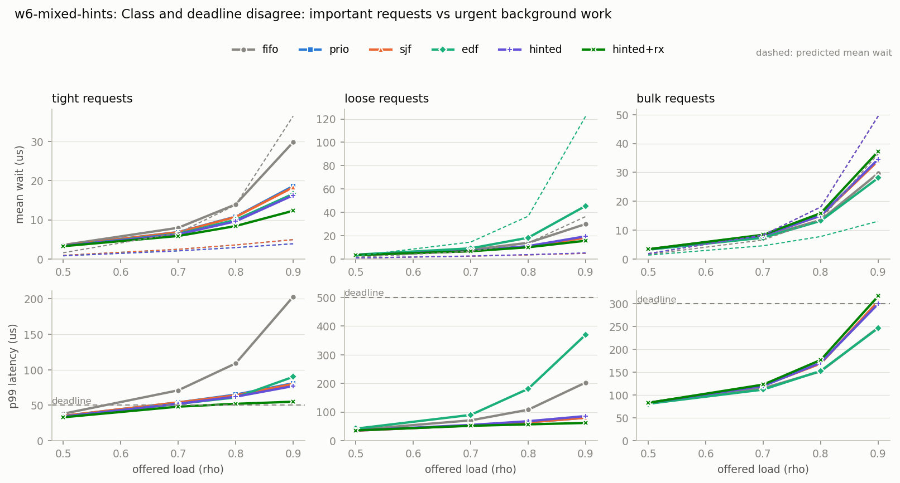

# Scheduling hints in Caladan: v1 report (superseded)

> **Superseded by [REPORT.md](REPORT.md) (v2).** Kept as written for the record; the v2 report lists which of its claims were wrong and why.

This report answers the five review questions on #5. The plan is in [DESIGN.md](DESIGN.md); this report follows it. Each step is a commit on this branch, and each step's results are posted as a comment on #7. Every number here comes from the final session, `s2`, unless stated otherwise. That session ran every policy on every workload, interleaved, with 3 repeats. Each number is a median of those repeats, measured at the client.



## The answers

**Q1. Is the cost of scheduling counted? Yes, measured three ways.**

1. **Cycles per decision** (microbenchmark, server CPU):
   - `fifo` costs about 5 cycles.
   - Each one-rule policy costs about 62 cycles at runqueue depth 2. A full 32-deep queue costs 275–626 cycles in cache, and up to 1031 cycles (430 ns) with the threads out of cache.
   - `hinted` costs 69 cycles at depth 2 and 867 / 1443 cycles at depth 32 (in / out of cache).
2. **In real runs:**
   - At a pick, the runqueue holds 1.1–1.8 threads on average.
   - Only 6–22% of picks have two or more threads, and only those call the policy.
   - The policy's share of server CPU is at most 0.13%.
3. **At saturation (W1):** this is a deliberate worst case of 1 µs requests, a full queue at every pick, and every thread carrying identical hints.
   - Carrying hints costs 3.3% of capacity.
   - One-rule policies cost another 3.1–3.8%.
   - `hinted` costs another 7.1%, and `hinted+rx` 7.6%.

**Q2. How do policies interact with Caladan's load balancing? Barely, and the reason matters.**

- Caladan balances load **before** a request becomes a thread. An idle core steals another core's *packet processing*, so a request's thread is often created on whichever core is idle.
  - Spreading the traffic over 4 connections instead of 64 changed nothing.
  - Making thread stealing follow hints also changed nothing (−2 to −4%, below noise), so it was removed.
- What limits hint-aware scheduling is **where a request waits before its thread exists**. Under load, a core turns packets into threads only when its runqueue is empty, so a new request waits behind every queued thread, whatever its class. That part of the wait (14.7 µs of 18.3 µs at ρ = 0.9) is the same under every policy.
- **One isolated change** (`runtime_sched_softirq_first`) processes arrived packets before the runqueue. With it, the latency-critical kind's p99 drops a further 24–43%.
- **Scalability:** each policy reads only its own core's queue and keeps no shared state. Its cost depends on queue depth (at most 32), not on the number of cores.

**Q3. Are the policies explainable? Each is one rule with a known property.**

| policy | rule | known property |
|---|---|---|
| `fifo` | oldest first | stock Caladan |
| `prio` | class first, then oldest | Cobham's formula |
| `sjf` | smallest hinted service time first | minimises mean wait without preemption |
| `edf` | earliest hinted deadline first | meets every deadline whenever any order can, if all requests are waiting (Jackson's rule) |
| `hinted` | class, then deadline, then service time, then oldest | picks exactly what `prio`, `edf` or `sjf` would when only one kind of hint is given (checked by `pickbench/policytest.c`) |

None of them has a tuned constant. All live in [`runtime/sched_policy.h`](../runtime/sched_policy.h).

**Q4. A handful of workloads, each explained by service times.** Six workloads, each with a prediction written before it ran. The predictions and what was measured are below.

**Q5. The best simple policy: `hinted`, ideally with `runtime_sched_softirq_first 1`.**

- `hinted` is the only policy that is never worse than the best single rule, beyond noise, on any workload. On W6, where class and deadline disagree, it beats every single rule.
- Adding packets-first processing (`+rx`) improves every latency-critical kind further.
- **The price is paid by long and background requests,** as the formulas say it must: W2b long requests' p99 is 244 µs under fifo, 289 under `hinted`, and 324 under `hinted+rx`. There is also the worst-case capacity cost in Q1.

## Setup and method

- **Testbed:** one CloudLab node, xl170 type: Xeon E5-2640 v4, ConnectX-4 Lx.
  - The server and the load generator both run on it, and the IOKernel loops packets between them.
  - The second node's NIC firmware (14.18) is too old for Caladan's DPDK driver, so it could not be used.
  - The IOKernel runs `ias noht`, so the server (4 cores, 2 in W1) and the client (4 cores) share no hyperthreads.
- **Requests:** a pure-CPU sqrt loop, at 326.9 iterations per µs. Packet handling and thread spawn add about 0.2 µs per request on top.
- **Load:** given as utilisation ρ = arrival rate × (mean service + 0.2 µs) / cores.
- **Repeats:** 3, with every policy interleaved within each repeat.
  - Noise between two sessions: at most 2% on p99 up to ρ = 0.8, 3.4% at ρ = 0.9.
  - A difference counts only beyond 5%.
  - The first session, `s1`, and the final session, `s2`, agree within that.
- **Wait:** a kind's mean latency minus the smallest latency seen for that kind. It is the time spent not running.
- **Predictions:** textbook formulas, computed in [`analyze.py`](analyze.py), in two versions:
  - **pooled:** one queue for all cores (M/G/k, Allen–Cunneen), with the priority split from Cobham's formula;
  - **per core:** each core its own M/G/1 queue, with no stealing.

## The workloads: predictions against measurements

**W1, overhead.** 1 µs requests on 2 cores, every request carrying the same hints.
- *Predicted:* every policy within 5% of fifo.
- *Measured:* the one-rule policies are within 5% of fifo with the same hints (3.1–3.8%), but `hinted` costs 7.1%. Against the stock build (measured in `s1`, so this compares sessions), the one-rule policies are 6.5–7.3% lower and `hinted` about 10% lower (1.150 vs 1.282 M req/s). **Partly right.**



**W2a / W2b, short requests behind long ones.** 80% take 5 µs and 20% take 50 µs. W2a hints only the service time; W2b hints only the class.
- *Predicted:* only the policy that reads the given hint helps, and short requests' mean wait drops several-fold while long requests pay.
- *Measured, ρ = 0.9:*
  - only `sjf` (W2a) or `prio` (W2b) helps, and `hinted` helps in both;
  - in W2b, short requests' p99 drops from 200 to 80 µs, and their mean wait from 29.5 to 18.3 µs;
  - long requests' p99 rises from 244 to 289 µs (`hinted`) and 297 µs (`prio`); W2a is within 2%.
- *Assessment:* **direction right, size off.** The gain in mean wait falls between the pooled prediction (5.0 µs) and the per-core prediction (22.6 µs). The reason is in Q2.

**W3, equal work, two deadlines.** 10 µs requests, all HIGH. 20% are due in 50 µs and 80% in 500 µs.
- *Predicted:* only `edf` helps, and the mean wait cannot change (Kleinrock's conservation law).
- *Measured:* `edf` and `hinted` cut the tight kind's misses from 5.1% to 1.45%. The traffic-weighted mean wait is 12.1 µs under fifo and 12.0 µs under `edf`. With `+rx`, the tight kind's misses fall to 0.02%. **Right.**



**W4, wrong hints.** W2a, but 10% of long requests claim to be short.
- *Predicted:* `sjf` degrades a little and is never worse than fifo.
- *Measured:* short requests' p99 is 87 µs, against 80 µs with honest hints and 199 µs under fifo. **Right.**

**W5, uneven load across cores.** W2b over 4 connections, and stealing that follows hints.
- *Predicted:* uneven per-core load, which hint-aware stealing would fix.
- *Measured:* 4 and 64 connections give identical results, and hint-aware stealing changed short requests' p99 by only 2–4%. **Wrong.** The wait split below explains why.



- **Policies only shrink the blue part.** At ρ = 0.9, ordering cuts runqueue waiting from 15 µs to 3.5 µs, and that is the whole gain.
- **The orange part is the same under every policy:** about 15 µs at ρ = 0.9.
- **Shortening the preemption quantum** to 25 or 10 µs left the orange part unchanged. It cost 410 k signal-based preemptions per run and multiplied long requests' waits. **Wrong again.**
- **What explains it:** `schedule()` turns packets into threads only when the runqueue is empty, when the 50 µs watchdog fires, or when an idle core steals the work. **`runtime_sched_softirq_first`** reverses that order, and the orange part shrank from 14.7 to 11.4 µs. What remains is about 3 µs of delivery jitter, plus the remainder of the handler already running, which no non-preemptive scheduler can remove.

**W6, class and deadline disagree.** Tight: 5 µs, HIGH, due in 50 µs. Loose: 5 µs, HIGH, due in 500 µs. Bulk: 50 µs, NORMAL, due in 300 µs.
- *Predicted:*
  - `prio` and `sjf` cannot separate tight from loose;
  - `edf` makes loose requests wait behind bulk work;
  - `hinted` gets both right, and bulk work pays.
- *Measured, ρ = 0.9:*
  - tight misses: 12.1% under `prio`, 11.7% under `sjf`, 9.4% under `edf` and `hinted`, 3.4% under `hinted+rx`;
  - loose p99: 370 µs under `edf`, 80 µs under `prio`, 86 µs under `hinted`, 62 µs under `hinted+rx`;
  - bulk requests met their 300 µs deadline 99.0% of the time, against 99.5% under fifo.
- *Assessment:* **right.**



## What I got wrong, and what it taught

1. **"Every policy within 5% of the stock build" (W1).** Carrying hints alone costs 3.3% at saturation, and `hinted` scans with three comparisons per thread. The cost is real but appears only when every pick sees a full queue.
2. **"Short-first cuts short requests' mean wait about 4×" (W2).** The pooled model assumes a waiting request takes the first core to free up. In Caladan it mostly waits on its own core.
3. **"Uneven connections make cores uneven, and hint-aware stealing fixes it" (W5).** Stealing packet processing already balances load. The remaining wait is before a request becomes a thread, where hints are not yet known.
4. **"A shorter quantum frees the packets" (W5-quantum).** Preempted threads rejoin the runqueue ahead of packet processing, and signal-based preemption is expensive without user interrupts.

## Limitations

- **One node, IOKernel loopback, no directpath.** The absolute latencies include the loopback path. Comparisons between policies were made under identical conditions.
- **Synthetic, constant service times.** The handlers are CPU loops with exact service times. Real handlers vary and touch memory.
- **Fixed cores.** Server cores were guaranteed and always spinning, so the IOKernel's core allocation (which also ignores hints) was not exercised.
- **`runtime_sched_softirq_first` was measured only on these workloads.** On packet-heavy workloads with little work per request, processing packets first may lose batching.

## Reproducing

```
cd study
cp nodes.json.example nodes.json    # fill in the nodes
./run.py workloads/w2b-hol-class.json --session mine --policy fifo,prio,hinted,hinted+rx
./analyze.py w2b-hol-class mine     # tables.md and plots/
./waitsplit.py w2b-hol-class mine short high
./scorecard.py mine                 # needs all of W1-W4 and W6 in that session
cc -O3 -march=native -o pickbench/pickbench pickbench/pickbench.c && pickbench/pickbench
cc -O2 -o pickbench/policytest pickbench/policytest.c && pickbench/policytest
```

`run.py` builds the pushed commit on the server, and each session's `meta.json` records it. Raw client output for every run is under `results/<workload>/<session>/raw/`.
