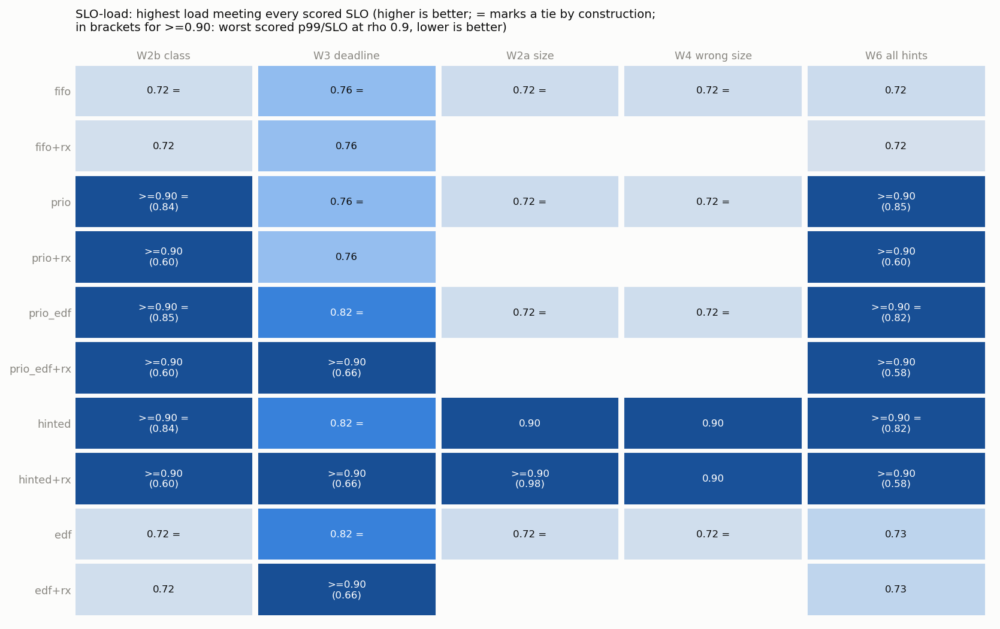
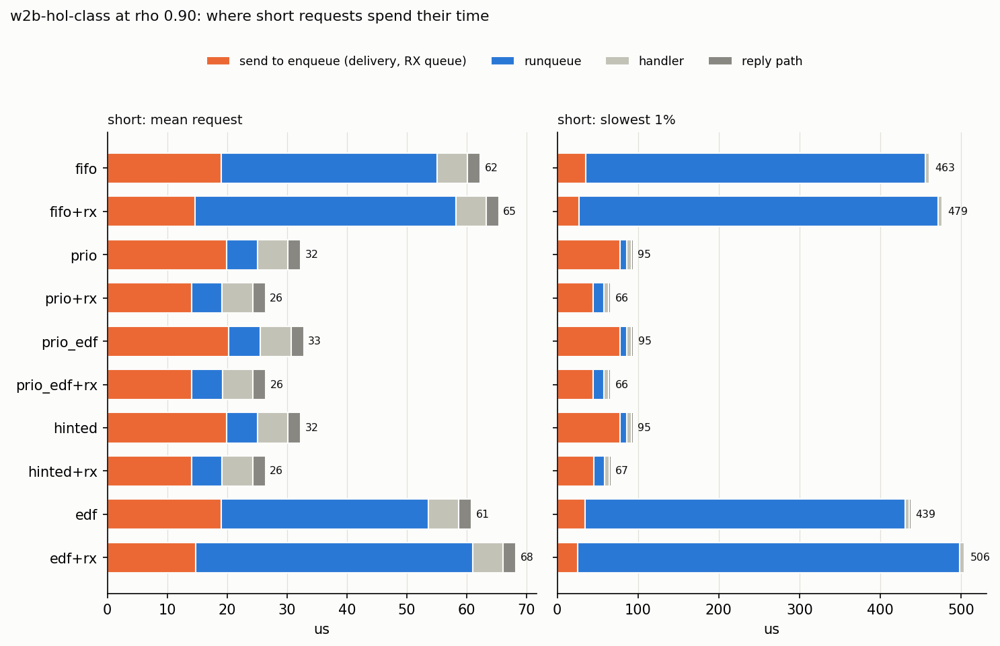
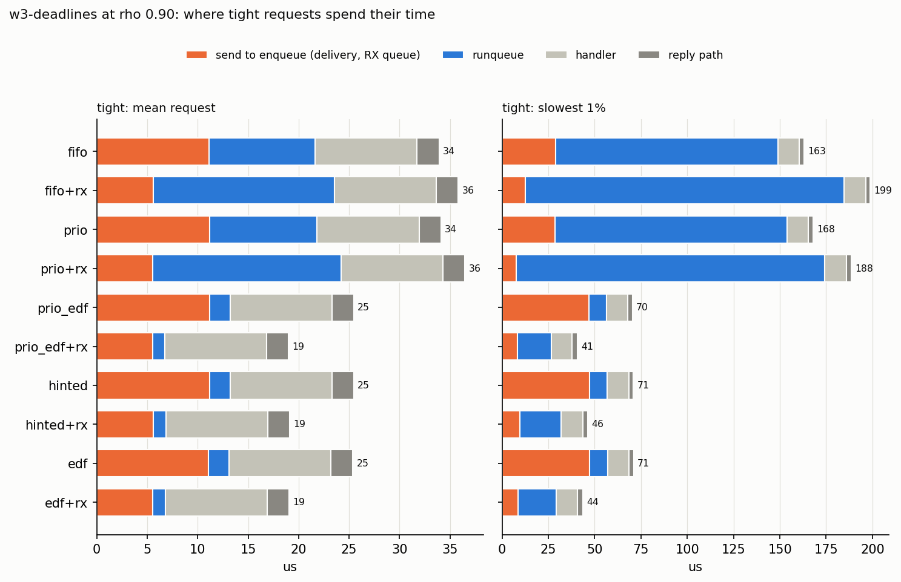

# Scheduling hints in Caladan: what the study found (v2)

This report answers the five review questions on #5.

- **Design.** The design was pre-registered in [DESIGN-v2.md](DESIGN-v2.md) before any v2 run, then amended twice, also before any run, after independent methods and design reviews.
- **History.** Version 1's report stays in [REPORT-v1.md](REPORT-v1.md). The last section lists what v1 got wrong.
- **Data.** Unless labelled otherwise, every number comes from session `v2`, interleaved, with 3 repeats (W1: 2 repeats, plus a 10 k second stage in the same session). The CPU clock was pinned at 2.4 GHz. Raw client output, tables and analysis code are under `study/`.
- **Other sessions, labelled where used:**
  - the in-run pick cost (`v2cost`, stats on);
  - the microbenchmark (`pickbench/results-v2-hp070.csv`);
  - the burst diagnostic (`diag`) and burst rerun (`v2b`).
- **Labels.** Results that were not pre-registered are labelled **post hoc**.



## The answers

**Q5 and Q3. A ladder of explainable policies, and the best one.**

Each thread's hints are packed once into a 64-bit key: class, then deadline, then expected service time. Each policy runs the queued thread with the smallest *prefix* of that key:

| policy | reads | rule |
|---|---|---|
| `fifo` | nothing | earliest ring slot (stock Caladan) |
| `prio` | class | highest class first |
| `prio_edf` | + deadline | then earliest deadline |
| `hinted` | + size | then smallest expected service time |
| `edf` (foil) | deadline only | earliest deadline, ignoring class |

Each rung only breaks the ties the rung below leaves. On the headline metric, the ladder climbs exactly as the information it reads allows. SLO-load is the highest load at which every latency-critical kind meets its SLO:

- **fifo** reaches 0.72–0.76 on every workload.
- **`prio`** lifts the class workloads (W2b, W6) to ≥ 0.9.
- **`prio_edf`** lifts the deadline workload (W3) from 0.76 to 0.82.
- **`hinted`** lifts the size workloads (W2a, W4) from 0.72 to 0.90.
- **`hinted+rx`** (packets processed before the runqueue) reaches ≥ 0.9 on W2b, W3, W2a and W6. On W4 it is 0.89–0.90: it crosses at 0.89 in 2 of 3 repeats, through the scored long kind.
- **Ties:** every cell the ladder makes identical by construction confirmed as a tie on SLO-load. On p99 the decision rule never calls two identical configurations different: 0 of 147 comparisons (86 ties, 61 inconclusive).

**The best policy is `hinted`.**
- It is one rule with no tuned constants, and it reaches ≥ 0.9 or 0.90 on every workload except W3 (0.82).
- Its worst-case capacity cost is 4.8% against `fifo` at the W1 knee, inside the 5% budget.

**`runtime_sched_softirq_first` (`+rx`) is an opt-in, with a trade.**
- **Gains:**
  - the favoured kinds' p99 falls 29% (48% for W3's tight kind);
  - W3's SLO-load rises to ≥ 0.9.
- **Costs:**
  - **Capacity:** 2.5% more at the W1 knee, putting `hinted+rx` at −7.2% against `fifo`. That is **outside the 5% budget.**
  - **Other kinds' tails** rise 3–46%. That includes kinds that are themselves scored: in W2a and W4, long requests' p99 worsens and W4's worst p99/SLO at 0.9 reaches 1.03.

**The price is paid by the kinds the order defers.** At ρ = 0.9:
- long requests' p99 is 18–44% above fifo's (W2b), and bulk work's 25–35% above (W6), 30–58% with `+rx`;
- `+rx` changes those kinds' p99 by −10% to +24% relative to the same policy without it.


**Q1. The cost of scheduling.** Measured three ways:
1. **Microbenchmark** (`pickbench/results-v2-hp070.csv`), **depth 32, in cache:** `prio_edf`, `hinted` and `edf` cost 428–456 cycles per pick. v1's `hinted` cost 867. `prio` costs 288, so the pre-registered "all within 15%" **failed** for `prio`. Timing the choice alone, `prio` 220 vs `hinted` 266: `prio`'s 2-bit class gives fewer distinct key values, so its "new minimum" branch is easier to predict.
2. **In real runs** (W2b, session `v2cost`, stats on): 52–68 cycles per call for every key policy at ρ = 0.8–0.9, and 38–68 over all loads (about 25 of them are the counter's own clock reads). The policy uses at most 0.11% of server CPU. A pick sees 1.3–2.9 threads on average.
3. **Capacity knee (W1, worst case):** carrying hints costs 4% (`stock` 1.30 M vs `fifo` 1.25 M req/s). The key policies cost another 2.4–4.8%, with `hinted` at −4.8%, inside the 5% budget, against 7.1% of collapsed goodput in v1. `+rx` costs a further 2.5%. See *Cost* below.

**Q2. Load balancing across cores.**
- **Two levels of stealing.** Caladan balances load at two levels, and v2 measures both per request:
  - idle cores steal *packet processing*: 10%, 25% and 34% of requests on 2, 4 and 6 cores;
  - idle cores steal *threads*: 9%, 15% and 19% under fifo.

  These shares are at ρ = 0.9. They are higher at light load (44% of packets at ρ = 0.5 in W2b).
- **Ordering's gain shrinks as cores pool the queue,** measured on unclipped quantities at ρ = 0.9:
  - fifo's short-request p99/SLO is 5.77, 3.60 and 2.58 on 2, 4 and 6 cores, against 0.89, 0.84 and 0.84 for `prio`;
  - the runqueue wait `prio` removes is 81 → 7, 36 → 5 and 22 → 4.5 µs.

  The SLO-load ratios (≥ 1.57, ≥ 1.24, ≥ 1.14) are lower bounds, because `prio` is censored at the top of the grid.
- **Where requests wait.** The deeper answer is where requests wait (next section): most of a favoured request's remaining wait happens before it becomes a thread, where no policy can act.
- **Burstable cores: ordering does not change the IOKernel's core grants** (session `v2b`; 2 guaranteed + 2 burstable cores next to a best-effort batch job). The pre-registered prediction **failed**.
  - In runs where the cores were granted, every policy used the same cores (3.10–3.11 at ρ = 0.7, 3.43–3.45 at 0.8).
  - The batch job's work rate was within 2% across policies (ρ = 0.7: fifo 1.60 M, `hinted` 1.61 M, `prio` 1.58 M units/s), not ≥ 5% lower under hint-aware ordering.
  - Separately, 14 of 36 runs at ρ ≥ 0.6 collapsed under every policy, because the IOKernel did not reclaim the batch job's cores (Limitations).

**Q4. A handful of workloads, explained by service times.** The six workloads are ordered by the information they need:

| workload | needs |
|---|---|
| W2b | class |
| W3 | deadline within a class |
| W2a | size |
| W4 | size, with wrong hints |
| W6 | every hint, conflicting |
| W5 | W2b on 2, 4 and 6 cores |

W1 measures cost. The queueing explanation is below; it holds only once the measured split is used.

## Where a request's time goes

Client and server share one node's TSC, so every request's latency splits into parts. The parts agree with the client's own latency to within 0.5 µs on average, which is its µs truncation.

There are rare outliers of about 180 µs. Repeats of the same cell with and without one agree within run-to-run spread; for example, W2b `hinted+rx`'s slowest-1% send → enqueue is 44.5 µs with an outlier against 45.1 and 45.1 without. So the tail numbers below stand.



**Short requests in W2b at ρ = 0.9:**
- **fifo:** the tail is head-of-line blocking in the runqueue. The slowest 1% wait 420 µs there.
- **Class-aware ordering removes that almost entirely:** 8 µs. The tail moves to *send → enqueue*, 78 µs. That is the time between the client sending and the server queueing the handler thread: delivery plus waiting in the receiving core's RX queue.
- **The rest of the path is flat with load:** the reply path stays at 2.1 µs from ρ = 0.5 to 0.9, and the client lag at −4 µs.
- **send → enqueue grows** from 3 µs to 20 µs (mean), identically under every policy.
- **In the slowest 1%,** only 1.3% of these packets were stolen (27% overall): they waited on their own core's RX queue behind a long handler.

**`+rx` moves that waiting into the runqueue.** There a policy can order it: the slowest 1% falls from 78 to 45 µs, and p99 from 84 to 60 µs.



**The `+rx` interaction.** Pre-registered: hint-aware policies gain 20–45%, and fifo stays within ±10%. The falsifier fired in part. The pattern, **post hoc**:
- **A kind gains only if its policy ranks it above the work it now overtakes.** The p99 of those kinds falls 29% (paired ratio 0.71 in every repeat) on W2b and W6. For W3's tight kind under deadline-aware rules it falls 48%, above the pre-registered 20–45% range.
- **Every other kind pays 3–46%.** That includes all kinds under orders whose hint carries no information in that workload: `prio` on W3, `edf` on W2b, and fifo, which rose up to +20% on W3 and +14% on W6, violating the pre-registered ±10%.

## The queueing explanation

**Pre-registered check: failed.** Mean waits were predicted with textbook formulas: pooled M/G/k (Allen–Cunneen) and per-core M/G/1, with Cobham's priority split. Measured as growth over ρ = 0.5, net of handler time, the check passes in only 40 of 180 cells:
- every fifo-like cell is 1.3–1.5× the pooled prediction;
- every favoured kind is above even the per-core bound (W2b short under `prio` at 0.9: 21.6 µs vs 4.0–12);
- only the deferred kinds land inside the bracket.

**Pre-registered secondary check: holds** ([stages.py](stages.py), [table](results/stages-v2.md)). The busy fraction includes packet processing, so it exceeds ρ: 0.838, 0.885 and 0.932 at ρ = 0.8, 0.85 and 0.9 in W2b. At the measured busy fraction, the pooled prediction for fifo is within −1% to +10% of the measured growth in all 15 fifo cells (five workloads, ρ = 0.8–0.9). At the nominal ρ it is 22–50% short. The quantitative SLO-load misses come from the same gap, and are reported as one finding:
- fifo-like rungs: 0.72–0.76, predicted 0.75–0.85;
- W3's deadline rung: 0.82, predicted 0.85–0.9.

**Post hoc: two stages.** A request waits first in a FIFO stage every policy shares (send → enqueue), then in the runqueue, which the policy orders.

- **The runqueue stage** ([stages.py](stages.py)). Subtracting the measured first stage leaves the favoured kinds' runqueue part. **3 of 4 fall inside the priority model's bracket** at the busy fraction, and W6 tight falls below it. The bracket spans about 3× (pooled to per core), so this is weak evidence, not a match:

| kind | measured | predicted (pooled – per core) |
|---|---|---|
| W2b short | 4.8 µs | 4.2–12 |
| W3 tight | 1.8 µs | 1.0–3 |
| W6 loose | 6.1 µs | 4.6–13 |
| W6 tight | 1.4 µs | 3.2–8 (below) |

- **The first stage, held-out test** ([`heldout.py`](heldout.py)). Two forms were tried, both fitted on W2b only and both reported, so the better one's error is optimistic: linear in the per-core residual work R = ρ·E[S²]/2E[S], and the Pollaczek–Khinchine shape R/(1−ρ).
  - **The form is tested only on W3,** the one held-out workload with another service mix. The P-K form transfers there only at light load: +4% at ρ = 0.5, then −28% to −38% at ρ ≥ 0.8. The linear form fails outright.
  - **Policy-independence holds.** W2a, W4 and W6 share W2b's cores and service mix, so for them the "prediction" is W2b's own measurement. They match it within a median 7%: the stage does not depend on policy.
  - **Core count matters.** On 2 and 6 cores the stage differs from W2b's by 19–69%: it is not independent of core count. That packet stealing pools it is a post-hoc guess, and untested.

## Workload by workload

Predictions are from DESIGN-v2.md; full tables are in `results/<workload>/v2/tables.md`.

**W2b, class only** (short 5 µs HIGH, long 50 µs NORMAL).
- fifo = `edf` = 0.72. The `prio` family is ≥ 0.9 (tie-break 0.84–0.85, a tie); `+rx` gives 0.60.
- Predicted: shape right; fifo's level missed (0.75–0.85 predicted).

**W3, a deadline within a class** (10 µs, 50 µs vs 500 µs deadlines, all HIGH).
- fifo = `prio` = 0.76. `prio_edf` = `hinted` = `edf` = 0.82, with paired ratios 1.08–1.09 in every repeat.
- With `+rx`, the deadline-aware rules reach ≥ 0.9. The tight kind's p99 drops 48%.
- Mean wait is conserved across orders within about 1.5% (Kleinrock).
- Predicted: shape right; levels missed (0.85–0.9 predicted for the rung).

**W2a, size only** (5 µs vs 50 µs, no class, no deadline).
- Only `hinted` separates: 0.90 (one repeat just below 0.9), against 0.72 for the four rungs that are fifo here.
- As predicted.

**W4, wrong sizes** (W2a with 10% of long requests claiming 5 µs).
- `hinted` stays at 0.90. Short-request p99 at 0.9 is 95 µs against 85 in W2a, keeping most of the gain.
- As predicted.
- **With `+rx`,** the scored long kind gets worse in both W2a and W4: 540 vs 498 µs, and 567 vs 526 µs against its 550 µs SLO. On W2a, `hinted+rx` vs `hinted` is inconclusive. On W4, `hinted+rx` crosses at 0.89 in 2 of 3 repeats.

**W6, every hint given; class and deadline disagree** (tight 5 µs HIGH due 100; loose 5 µs HIGH due 300; bulk 50 µs NORMAL due 100).
- `prio` = `prio_edf` = `hinted` ≥ 0.9, as predicted. `hinted` = `prio_edf` exactly, a construction check.
- **`edf` = 0.73: a tie with fifo, failing on both scored kinds** (tight p99 333 µs, loose 539 µs at 0.9).
- The prediction (≈ 0.85, failing on loose) was **wrong in magnitude and mechanism.** The second amendment's own parameters gave tight and bulk the same 100 µs offset, so EDF serves them first-come-first-served and tight waits behind 50 µs bulk jobs. In effect W6 tested "equal deadline offsets reduce EDF to FIFO".
- **What is not shown:** that class must come before deadline. The foil failed for another reason. The ladder's class-first order is justified by what the hints mean, not by this measurement.

**W5, cores.**
- **2, 4 and 6 cores:** above, under Q2.
- **Burstable cores:** see Limitations.

## Cost (W1)

**The workload is a deliberate worst case:**
- 1 µs requests on 2 cores;
- every thread carries identical hints, so every pick scans the whole ring, 32 deep at saturation.

**The capacity knee** is the highest offered load at which every repeat has zero drops and p99 ≤ 70 µs. Each level runs on a fresh server for 10 s. The search uses a 40 k grid, then a 10 k second stage inside each bracket, 2 repeats each ([knee.md](results/w1-overhead/v2/knee.md)).

| configuration | knee | vs `fifo` |
|---|---|---|
| `stock` (hints compiled out) | 1.30 M req/s | +4.0% |
| `fifo` | 1.25 M | – |
| `prio` | 1.22 M | −2.4% |
| `prio_edf` | 1.21 M | −3.2% |
| `edf` | 1.21 M | −3.2% |
| `hinted` | 1.19 M | −4.8% |
| `hinted+rx` | 1.16 M | −7.2% |

**Against the pre-registered predictions:**
- **`stock` above `fifo` by more than one step:** holds. Carrying hints costs 4% here: the classifier on every packet, and the hint fields.
- **Each key policy within 5% of `fifo`:** holds by the pre-registered rule, at the margin; it is not robust to one step.
  - `hinted` is at −4.8%, one step from the bound.
  - `prio_edf`'s contiguous knee is 1.18 M (−5.6%).
  - Each level was run only twice.
- **`hinted+rx` has the lowest knee:** holds.
- **The four key policies within one 10 k step of each other:** **fails.** They span three steps (1.19–1.22 M, 2.5%), with `hinted` lowest. One step is about the run-to-run noise here (`prio_edf` passes 1.20 M and 1.21 M in both repeats but 1.19 M in only one).

In v1, `hinted` cost 7.1% of collapsed goodput, about twice a single rule. Below saturation the policy's cost is invisible (Q1, item 2).

## Noise and the decision rule

- **The decision rule.** A difference counts only if all three paired ratios lie beyond ±5% on the same side. A tie needs all three within ±5%; anything else is inconclusive. At the top of the grid, configurations are compared by the worst scored p99/SLO at ρ = 0.9.
- **A/A tests.** The configurations identical by construction were compared on every kind's p99 at ρ = 0.8–0.9, pair by pair:
  - **Medians** differ by 0–4.8% on scored kinds, except one pair at 8.4% (W4's fifo-like rungs at 0.9), and by up to 10% on price kinds.
  - **Per repeat,** paired ratios range 0.80–1.11 at ρ = 0.9 (widest in W4's fifo-like cells near saturation).
  - **The rule held up:** because it needs all three repeats beyond ±5% on the same side, it called none of the 147 A/A comparisons different (86 ties, 61 inconclusive).
  - **Consequence:** price differences *between* hint-aware configurations are within this noise, so only differences against fifo are reported.

## What v1 got wrong, now corrected

1. **`hinted` "never worse than the best single rule"** held by construction, not measurement.
   - In v2 the ties are labelled as construction checks.
   - The single rules (`sjf`, which was the same algorithm as `prio` under per-kind hints, and `edf`) are replaced by a ladder plus one foil.
2. **"`hinted` beats every rule on W6"** switched metrics. v1's W6 tied `edf` on deadline misses.
3. **W1's "capacity" was goodput after collapse.** v2 uses a knee search.
4. **The cost of `hinted`** was 2× a single rule. v2 packs the hints into a sort key, so all policies compare one word.
5. **The W5-quantum explanation was wrong:** `thread_yield()` does process packets.
6. **The "before the thread exists" part was an inferred residual.** v2 measures it per request.
7. **The pooled predictions were written after the v1 runs.** v2's predictions were committed first.
8. **The clock floated** (schedutil governor, turbo). v2 pins it.

## Limitations

- **One node.** Server and client share it through the IOKernel's loopback, with no directpath. Absolute latencies include that path. Comparisons are within identical conditions.
- **Synthetic CPU-only handlers** with constant service times per kind. Hints are set per request kind by a classifier.
- **ρ omits packet processing.** The busy fraction runs about 0.03–0.05 above ρ.
- **Rare timing outliers.** In 306 of 2232 (configuration, load, kind) cells, at least one request's timestamps disagree with the client's own measurement by more than 5 µs (up to 246 µs). They barely move the means, but can enter the slowest-1% subsets.
- **send → enqueue mixes delivery and RX-queue wait.** There is no IOKernel arrival stamp. Delivery is attributed from the flat reply path and the light-load value.
- **W5 burst (2 guaranteed + 2 burstable cores, a best-effort batch job).**
  - **First runs (session `v2`):** one server instance swept all six levels. Many levels collapsed: the burstable cores were not granted, and the server stayed at 2.0 cores with zero parks.
    - Collapsed = failed or p99 > 100 ms. At ρ = 0.6–0.8 that was fifo 3/9, `prio` 7/9, `hinted` 3/9 and `hinted+rx` 6/9 levels. An earlier count of 5/9 for `prio` used an unstated definition.
    - Collapses were not monotone in load, and the batch job's rate was lost to a harness bug.
  - **Diagnostic (session `diag`):** fifo at ρ = 0.7, a fresh server for each of 6 runs, IOKernel statistics on. **All 6 were healthy:** 3.1 cores, about 55 k batch-job preemptions per run, batch job at about 1.70 M units/s.
  - From that diagnostic I concluded, in the third amendment, that the collapses came from state carried over between levels. **The rerun refuted that.**
  - **The rerun (session `v2b`):** a fresh server per level, prediction unchanged. Collapses still occurred at random levels from ρ = 0.6 up: fifo 3/9, `prio` 4/9, `hinted` 2/9 and `hinted+rx` 5/9.
    - In each, the server stayed near 2 cores while the batch job kept its full rate (about 1.825 M units/s, its light-load rate). The IOKernel did not reclaim the burstable cores.
    - The diagnostic's 6/6 healthy runs happened to fall at a level that was also healthy in all 3 rerun repeats.
  - **Why the IOKernel sometimes fails to reclaim cores** from a best-effort job here (one node, loopback, `noht`) is not diagnosed. It occurs under every policy.
  - **The pre-registered question was answered from the healthy runs:** no policy effect on cores granted or on the batch job's rate (within 2%).
- **Hint-aware stealing** (v1) was tested only with `prio` and the stock packet order, not with `+rx`.

## Reproducing

```
cd study
cp nodes.json.example nodes.json                     # fill in the node
./run.py workloads/w2b-hol-class.json --session mine # all ladder configurations, 3 repeats
./v2.py w2b-hol-class mine                           # tables.md and plots
./v2.py --split short w2b-hol-class mine             # the time-split figure
./v2.py --scorecard mine                             # the ladder scorecard and A/A noise
./v2.py --knee w1-overhead mine                      # W1 capacity
./heldout.py mine                                    # held-out test of the two-stage model
cc -O2 -o pickbench/policytest pickbench/policytest.c && pickbench/policytest
```
